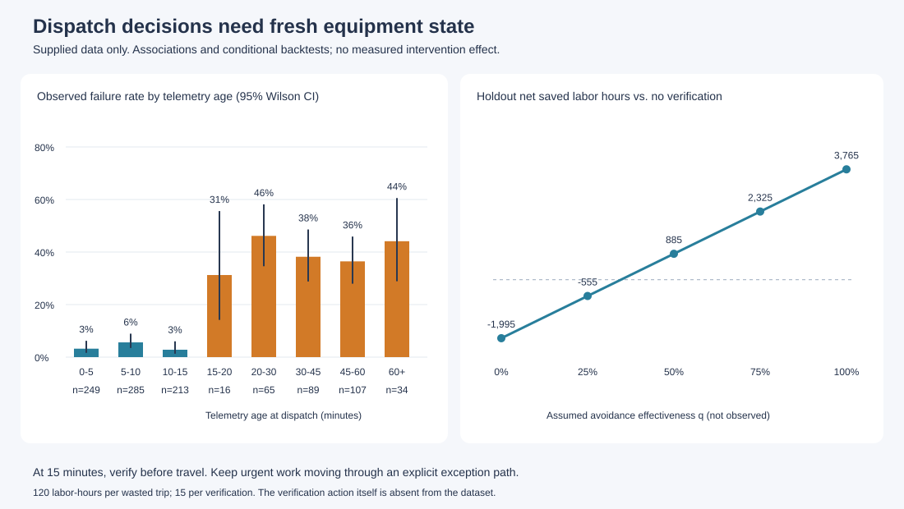

# 减少预防性检修空跑：让派工依据保持新鲜

只分析题目提供的 maintenance_tasks.csv，按每次空跑 **120 工时**、每次前置核实 **15 工时**计算。没有补造业务样本，也没有引入外部数据。原始 CSV 原样保存在 [data/maintenance_tasks.csv](data/maintenance_tasks.csv)。

## 我的判断

**优先排查遥测时效与派工放行之间的缺口，并先试点“遥测年龄达到 15 分钟，出发前核实”的简单规则。** 健康度低反映紧急程度，不能单独保证系统掌握的是当前工况。

去重且有结果的 1,058 个任务中，153 次空跑，空跑率 **14.46%**。由派工时间减去遥测更新时间得到的遥测年龄，和空跑有明显关联：

| 派工时遥测年龄 | 已知结果任务 | 空跑 | 空跑率 | 95% Wilson 区间 |
| --- | ---: | ---: | ---: | ---: |
| 小于 15 分钟 | 747 | 30 | **4.02%** | 2.83%–5.68% |
| 至少 15 分钟 | 311 | 123 | **39.55%** | 34.27%–45.08% |

Wilson 区间按任务独立的二项近似计算；缺少设备 ID，无法校正重复设备或班组聚类，也不是因果效应区间。

后者约为前者的 **9.85 倍**；这 29.40% 的任务包含了 80.39% 的已知空跑。不同设备类别和不同健康度分组内也存在同向差异，详见 [设备分层](reports/device_cross.csv) 和 [健康度分层](reports/health_cross.csv)。分层只能减少明显的构成混淆，不能替代因果识别。

**当前能确认的是风险关联；无法凭这份表确认网络故障、缓存失效或某条派工规则就是技术根因。** 表中没有现场真实状态、状态变更事件、接口接收日志、到场时间或设备唯一编号。根问题的首要假设是：较旧的状态仍被用于当前派工，缺少有效的新鲜度核验。具体故障环节需后续现场核对，本文没有使用任何额外日志作结论依据。

## 数据检查改变了哪些判断

| 检查项 | 数据结果 | 处理 |
| --- | ---: | --- |
| 原始行数 | 1,163 | 保留原始文件 |
| 完全重复的多余记录 | 55 | 删除重复计数，保留审计行号 |
| 去重后任务 | 1,108 | task_id 唯一，无冲突版本 |
| 去重后结果缺失 | 50 | 不填成 0 或 1；有结果的分析分母为 1,058 |
| 空跑 / 成功 | 153 / 905 | 按题目标签定义解释 |
| 不带时区、时间倒置、非法标签等被隔离记录 | 0 | 脚本检查，未来输入有问题会单列 |
| 连续运转时长大于 24 小时 | 1,064 / 1,108 | 与“当天”口径矛盾，排除出主策略选择 |

时间覆盖为 **2026-09-01 至 2026-09-07（UTC+8）**。dispatch_time 带 +08:00，telemetry_synced_at 带 Z；必须作为带时区时间相减，不能删掉时区后相减。例如任务 1033 的 07:16+08:00 与前一日 23:14Z 相差 **2 分钟**。

全体去重任务的真实空跑率，考虑 50 个缺失结果后的范围为 **13.81%–18.32%**。这是缺失标签的极端边界，不是置信区间。[数据审计](reports/quality_audit.csv) 可追溯每条删除记录；缺失标签保持为空。

## 做了什么

1. 审计重复、缺失、主键、时间和字段口径，保留原始字节与 SHA-256。
2. 只构造派工时已知的遥测年龄；规则不读取 task_success。按时间分开选择与评估，避免同一任务跨集合。
3. 用 **9 月 1–4 日的 584 个有结果任务**选择策略；用 **9 月 5–7 日的 474 个有结果任务**回测。
4. 在训练期比较 198 个简单候选：不核实、全部核实、遥测年龄阈值、年龄阈值加单一区域例外、健康度阈值、单一区域和单一设备类别。年龄阈值网格为 0–120 分钟，每 5 分钟一个值；按题目成本在假设核实完全有效时最大化净节省，平局时优先更少核实、更简单的规则。运转时长仅作诊断对照。
5. 训练期选中的规则是 **遥测年龄 ≥15 分钟则前置核实**。训练期 14–17 分钟给出相同分组，且样本在这一带稀疏；15 分钟是便于执行的候选阈值，**不是证实的物理失效临界点**。
6. 输出逐任务核实建议、候选搜索、分层计数、成本对照、阈值及有效性敏感性分析，见 [reports](reports)。

初步全量探索发生在时间切分之前，之后又做过分区与阈值探索。因此这里是**探索后的时间回测**，不能包装成完全未接触的独立测试。没有用回测结果重选最终规则；真正的前瞻验证仍需现场试点。

## 怎么证明有用

先证明历史数据中有可识别、在后段日期仍存在的风险集中，再按明确假设测算核实是否划算。仅用分类准确率无法回答是否值得核实。

设核实组内本会空跑的任务数为 F，核实任务数为 N，核实真正避免空跑的比例为 q：

> 净节省工时 = 120 × q × F − 15 × N

q 是未知的干预有效性，**这份数据没有测量它**。核实正常任务同样花 15 工时；未命中的空跑照样损失 120 工时。未包括核实导致的额外排队和机会成本。15 工时是题目给的人工投入，15 分钟是遥测年龄阈值，不能混淆两种单位。

### 后段日期回测（仅有结果的 474 单，q=100% 情景）

| 策略 | 核实单数 | 核实组中的历史空跑 | 剩余空跑 | 核实工时 | 剩余空跑工时 | 合计工时 | 比不核实净节省 |
| --- | ---: | ---: | ---: | ---: | ---: | ---: | ---: |
| 不核实 | 0 | 0 | 63 | 0 | 7,560 | 7,560 | 0 |
| 全部核实 | 474 | 63 | 0 | 7,110 | 0 | 7,110 | 450 |
| 遥测年龄 ≥15 分钟核实 | **133** | **48** | **15** | **1,995** | **1,800** | **3,795** | **3,765** |

选择性核实覆盖 **28.06%** 的任务，核实组历史空跑占比 **36.09%**（95% Wilson 区间 28.42%–44.54%），包含 **76.19%** 的历史空跑。在 q=100% 的情景下，损失与核实合计投入下降 **49.80%**，比全部核实少投入 **3,315 工时**。仍有 85 个本会成功的任务接受核实，成本已经计入。

所有对照的阈值/区域/设备类别均用训练期挑选，后段净节省分别为：健康度规则 **450 工时**（训练期最优阈值 30，等同全核实）、单一区域规则 **−30 工时**、单一设备类别规则 **−195 工时**；运转时长诊断对照为 **885 工时**，因口径矛盾不部署。详见 [逐策略回测](reports/policy_evaluation.csv)。

### 核实不一定有效：收益对 q 很敏感

| 核实避免命中空跑的比例 q（假设） | 后段净节省工时 |
| --- | ---: |
| 0% | −1,995 |
| 25% | −555 |
| 50% | **885** |
| 75% | **2,325** |
| 100% | **3,765** |

该组任务的历史盈亏平衡点为 **q >34.64%**。一般而言，预计空跑概率 p 满足 p × q >12.5% 时，按本题成本核实才有正的期望净收益。q=50% 时所需 p 超过 25%。这些条件解释了为什么不应全量加核实。

后段还有 26 单结果缺失，其中 7 单会被规则选中。部署到完整后段 **500 单**时应核实 **140 单**。即使把这 7 单全部视为本会成功，也要计入它们 **105 工时**的核实成本。于是 q=100% 时净节省的缺失标签边界为 **3,660–4,500 工时**；这是条件测算的边界，仍不代表已观察到的干预收益。若按完整 500 单的核实成本、并保守地假设缺失核实单本可成功，盈亏平衡点升至 **36.46%**；q=50% 时仍净节省 **780 工时**。

全量 1,058 个有结果任务的描述性测算为：核实 311 单、核实组含 123 次历史空跑、净节省 10,095 工时（q=100%）。这是含训练数据的数值，不作为独立验证成绩。包含缺失任务的全量核实数为 326 单，对应净节省边界为 9,870–11,670 工时。

### 不把区域或设备标签误当根因

| 区域 | 年龄 <15 分钟 空跑/有结果 | 年龄 ≥15 分钟 空跑/有结果 |
| --- | ---: | ---: |
| 一号机组区 | 5/147（3.40%） | 30/67（44.78%） |
| 二号机组区 | 4/138（2.90%） | 30/55（54.55%） |
| 水处理车间 | 4/152（2.63%） | 27/59（45.76%） |
| 输煤转运站 | 5/150（3.33%） | 28/58（48.28%） |
| 烟气净化区 | 12/160（7.50%） | 8/72（11.11%） |

烟气净化区是重要反例：不能声称所有区域都存在同样强的时效效应。训练期为它设例外只比全区规则少节省 15 工时，证据不足以支持长期豁免，因此保留简单统一规则作为首轮试点，并单独监控该区；核实能力受限时，先覆盖另外四区的陈旧遥测任务。这一试点排序建议尚未经过前瞻验证。

15 分钟附近的稳健性检查显示，20 分钟规则在训练期/后段分别净节省 6,195/3,540 工时；15 分钟规则为 6,330/3,765。风险信号不依赖唯一一个精确分钟，但不能据此声称任意时段均有效。详见 [阈值敏感性](reports/threshold_sensitivity.csv)。

## 落地策略与验证闭环

- **先改变派工入口。** 当前 dispatch_time 已意味着工程师出发，真实部署需将核实放在释放出勤之前。年龄达到 15 分钟，拉取新状态并确认当前任务条件；发现不符时纠正记录并协调重排，不能把取消或无限延期计为成功。低健康度仍用于紧急顺序，未知状态和紧急任务进入明确的人工响应通道，不能因为等待核实被挂起。
- **把核实变成可测的动作。** 记录核实开始/结束、发现的差异、更新后的状态、是否仍出勤、最终是否开工及完成。核实组的正常任务继续检修。15 人工工时不能被当成固定的经过时长；现有表没有核实人力容量，不能承诺调度吞吐不受影响。
- **按证据追查具体故障。** 优先抽查四区的陈旧遥测空跑单，对齐状态事件时间、系统接收时间、派工读取版本及现场状态，区分上游未更新、同步延迟、缓存陈旧和出发后变化；同时抽查新鲜遥测仍空跑的 30 单与烟气净化区反例。仅是下一步取证要求，不是本报告已经获得的新数据。
- **先影子运行，再小范围对照。** 确认数据质量和核实容量后，按可比产线/班组分批启用，保留符合现场要求的对照。评估空跑人时 + 核实人时 + 新增等待/排队损失，并监控实际开工量、到期完成率、积压账龄和紧急任务响应时间。不得通过减少派工量来“改善”空跑率。
- **扩大条件。** 核实组实际空跑避免率与核实投入支持正净收益，且紧急响应、有效开工和到期完成没有恶化，才扩大；净收益转负、关键任务延误或核实排队不可控时停止扩大并复核。现有数据只有 7 天，缺设备 ID 和到场/开工时间，不能估计长期稳定性、重复设备相关性或紧急隐患 SLA 的实际改善。

## 可复现步骤

需要 **Python 3.10+，仅标准库，无需 pip install，无网络请求**。在仓库根目录运行：

~~~bash
python analyze.py
python -m unittest discover -s tests -v
~~~

可指定输入、输出与时间切分：

~~~bash
python analyze.py --input data/maintenance_tasks.csv --output reports_reproduced --split-date 2026-09-05
~~~

[analyze.py](analyze.py) 一次生成全部报告；[metrics.json](reports/metrics.json) 是机器可读主结果，[policy.json](reports/policy.json) 保存训练所得规则，[task_decisions.csv](reports/task_decisions.csv) 给出每个任务的核实建议和集合归属。reports 中派生文件均可覆盖重建。

原始文件为 **106,998 字节**，SHA-256：

~~~text
455a57d85005c2d367a9eaa50f89406273573dfeed830d59fba82a500a0b7b54
~~~

已在 Python 3.12.14 运行分析与 **10 项测试**，覆盖时区、去重、缺失标签、冲突隔离、规则边界、无结果泄漏、成本恒等式及原始数据端到端结果。测试中的人工小样本均明确标注 TEST DATA ONLY，只验证程序，不进入分析结果。

AI 使用与修正过程见仓根 [AI_LOG.md](AI_LOG.md)。所有业务数值均来自本题 CSV 或题目给定的 120/15 工时；q 的不同取值是明确标注的情景假设。
